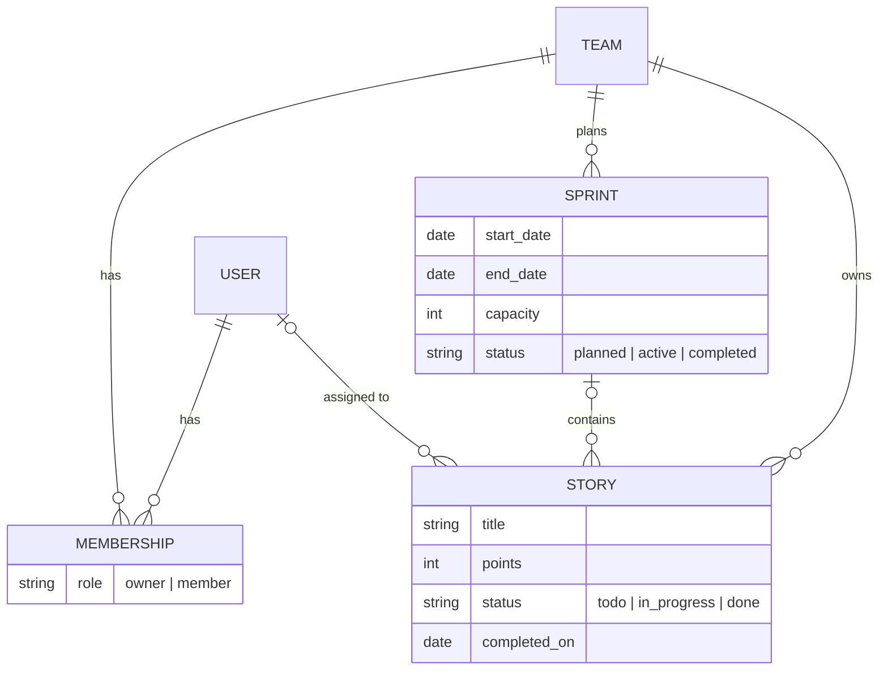

# Sprint Planner API


A REST API for planning Scrum sprints as a team. It supports user accounts with JWT authentication, teams with roles, a product backlog, sprints with capacity limits, **burndown charts** and **velocity forecasting**.

Built with **FastAPI, SQLAlchemy 2.0 and Pydantic v2**. It runs on SQLite for development and **PostgreSQL in Docker** for production.

**Front end:** [sprint-dashboard](https://github.com/volaitan/sprint-dashboard) (React + TypeScript).

It grew out of my [kanban-board](https://github.com/volaitan/kanban-board) project and my postgraduate study in agile project management. It enforces the rules a Scrum team actually works by, not just stores data.

## Agile rules the API enforces

| Rule | Behaviour |
|---|---|
| One active sprint per team | Starting a second sprint returns `409` and names the one still running |
| Sprint capacity | Adding or re-pointing stories beyond capacity returns `409` (override with `?force=true`) |
| Can't start an empty sprint | Add stories first |
| Sprint review | Completing a sprint sends unfinished stories **back to the backlog**, and records the original commitment, so velocity still shows committed vs completed |
| Completed sprints are closed | They can't be edited and can't take new stories |
| Team privacy | Non-members get `404`, not `403`, so team ids can't be probed |
| Roles | Only owners manage members, and a team can't lose its last owner |
| Assignees | Must be members of the team |

## Reports

**Burndown:** `GET /sprints/{id}/burndown` returns the ideal line and the actual remaining points for each day of the sprint, ready to plot:

```json
{
  "sprint_id": 1,
  "committed_points": 10,
  "days": [
    {"date": "2026-01-05", "ideal": 10.0, "remaining": 10},
    {"date": "2026-01-06", "ideal": 7.5,  "remaining": 5},
    {"date": "2026-01-07", "ideal": 5.0,  "remaining": 2},
    {"date": "2026-01-08", "ideal": 2.5,  "remaining": null},
    {"date": "2026-01-09", "ideal": 0.0,  "remaining": null}
  ]
}
```

**Velocity:** `GET /teams/{id}/velocity` returns committed and completed points for each finished sprint, the overall average, and a forecast for the next sprint (the rolling average of the last three sprints).

## Data model



## Endpoints

| Method | Path | |
|---|---|---|
| POST | `/auth/register` | Create an account |
| POST | `/auth/login` | OAuth2 password flow → JWT |
| GET | `/auth/me` | Current user |
| GET / POST | `/teams` | List my teams / create a team (you become owner) |
| GET | `/teams/{id}` | Team with members |
| POST / DELETE | `/teams/{id}/members[/{user_id}]` | Add by email / remove (owners only) |
| GET / POST | `/teams/{id}/sprints` | List / create sprints |
| GET / PATCH | `/sprints/{id}` | Read / edit a sprint |
| POST | `/sprints/{id}/start` · `/complete` | Sprint lifecycle |
| GET | `/sprints/{id}/burndown` | Burndown data |
| GET | `/teams/{id}/velocity` | Velocity and forecast |
| GET / POST | `/teams/{id}/stories` | Filter by `backlog`, `sprint_id`, `status` or `assignee_id` / create |
| GET / PATCH / DELETE | `/stories/{id}` | Read / update / delete a story |

Set `CORS_ORIGINS` (comma-separated) to let a browser front end such as sprint-dashboard call the API.

Interactive docs are at **`/docs`** (Swagger UI) and **`/redoc`** once the server is running.

## Run it

**With Docker** (API + PostgreSQL):

```bash
git clone https://github.com/volaitan/sprint-planner-api.git
cd sprint-planner-api
SECRET_KEY=$(python -c "import secrets; print(secrets.token_urlsafe(48))") docker compose up --build
```

Then open http://localhost:8000/docs.

**Locally** (SQLite):

```bash
python -m venv .venv && source .venv/bin/activate
pip install -r requirements-dev.txt
uvicorn app.main:app --reload
pytest -v
```

**Quick tour with curl:**

```bash
curl -X POST localhost:8000/auth/register -H "Content-Type: application/json" \
     -d '{"email":"me@example.com","name":"Me","password":"password123"}'
TOKEN=$(curl -s -X POST localhost:8000/auth/login -d "username=me@example.com&password=password123" | python -c "import sys,json;print(json.load(sys.stdin)['access_token'])")
curl -X POST localhost:8000/teams -H "Authorization: Bearer $TOKEN" -H "Content-Type: application/json" -d '{"name":"Web Team"}'
```

## Project structure

```
app/
├── main.py          # App, routers, startup
├── config.py        # Settings from environment variables
├── database.py      # SQLAlchemy engine and session dependency
├── models.py        # User, Team, Membership, Sprint, Story
├── schemas.py       # Pydantic request/response models and validation
├── security.py      # bcrypt hashing, JWT creation and verification
├── deps.py          # Membership and ownership checks
├── reports.py       # Burndown and velocity (pure functions)
├── clock.py         # "Today": replaceable in tests to simulate a sprint
└── routers/         # auth, teams, sprints, stories
tests/               # 21 API tests: in-memory SQLite, fake clock
```

## Testing and CI

The test suite uses an in-memory SQLite database and a fake clock, so it can step through a sprint day by day and check the burndown exactly. GitHub Actions runs the tests, builds the Docker image and smoke-tests `/health` on every push.

## Possible next steps

- Alembic migrations
- A front end with charts (React or HTMX)
- Refresh tokens and rate limiting

## Licence

MIT
